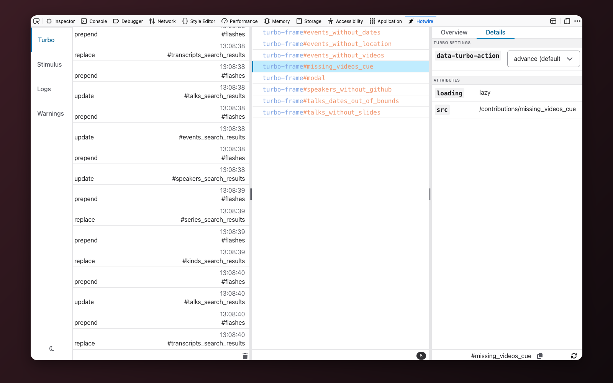

<div align="center">

# Hotwire Dev Tools

**Hotwire Dev Tools is a browser extension to inspect and debug Turbo and Stimulus applications.**



[](https://addons.mozilla.org/en-US/firefox/addon/hotwire-dev-tools/)
[](https://chromewebstore.google.com/detail/hotwire-dev-tools/phdobjkbablgffmmgnjbmfbbofnbkajc)
[](https://apps.apple.com/ch/app/hotwire-dev-tools/id6503706225)

</div>

## Features

The extension adds a **Hotwire** panel to your browser's DevTools.  
Hover any element in the panel to highlight it on the page, scroll to it, or jump to it in the Elements panel.

### Turbo

- Tree of all Turbo Frames, including nested frames, their attributes and the links and forms that target them
- Reload a single Turbo Frame from the panel
- Live feed of incoming Turbo Streams with action, target and HTML, including streams rendered before the panel was opened
- Flags Turbo Streams whose target doesn't exist on the page
- Connection status of Turbo Stream WebSockets
- Current Turbo settings: Turbo Drive, visit control, cache control and link prefetch
- Elements with `data-turbo-permanent` and `data-turbo-temporary`

### Stimulus

- All Stimulus controllers on the page
- Inspect and edit values live
- Targets, outlets, classes and actions of each controller
- Trigger controller actions from the panel
- Flags controllers that aren't registered in `window.Stimulus`

### Logs

- Every Turbo event (`turbo:load`, `turbo:frame-load`, `turbo:before-fetch-request`, …) with filter and details

### Warnings

- Duplicate Turbo Frame IDs
- `data-controller` without a registered Stimulus controller
- Stimulus targets outside their controller
- `data-turbo-permanent` elements without an ID or with a duplicate ID
- Mute single warnings per site

### On-page tools

These work without opening DevTools and are configured in the extension popup:

- Highlight Turbo Frames and Stimulus controllers on the page
- Highlight Turbo Frame changes
- In-page detail panel with Stimulus controllers, Turbo Frames and Turbo Streams
- Log Turbo Streams, Turbo events and warnings to the browser console

## Installation

The extension can be installed at:

- [Firefox Add-ons](https://addons.mozilla.org/en-US/firefox/addon/hotwire-dev-tools/)
- [Chrome Web Store](https://chromewebstore.google.com/detail/hotwire-dev-tools/phdobjkbablgffmmgnjbmfbbofnbkajc)
- [App Store for Safari](https://apps.apple.com/ch/app/hotwire-dev-tools/id6503706225)

## Usage

**DevTools panel:** Open your browser's DevTools (on Safari: Develop → Show Web Inspector) and select the **Hotwire** tab.

**On-page tools:** Click the extension icon (or press Alt+Shift+S) and enable the features you want to use.

> [!NOTE]
> On Firefox you may need to select "Always allow on example.com" to enable the extension on your site

## Development

- Fork the project locally
- `npm install`
- `npm run dev` - to build the extension and watch for changes
- `npm run dev:panel` - to work on the DevTools panel UI with mock data at http://localhost:3333/dev.html, without reloading the extension
- `npm run build` - to bundle the extension into static files for production
- `npm run format` - to format changes with Prettier

> [!NOTE]  
> By default, the extension will be built for Chrome. To build for Firefox or Safari just add `firefox` or `safari` as an argument to the build command: `npm run build firefox` or `npm run build safari`.

### Test on Chrome

1. Open Chrome and navigate to `chrome://extensions/`
2. Enable Developer mode
3. Click on `Load unpacked` and select the `public` folder (make sure to build the extension first)

### Test on Firefox

The easiest way is to make use of the [web-ext](https://extensionworkshop.com/documentation/develop/getting-started-with-web-ext/) tool:

```bash
cd public
npx web-ext run
```

That will open a new Firefox instance with the extension installed and hot reloading enabled.

### Test on Safari

First [configure Safari to run unsigned extensions](https://developer.apple.com/documentation/safariservices/safari_web_extensions/running_your_safari_web_extension#3744467):

1. Choose Safari > Settings
2. Select the Advanced tab
3. Check the "Show features for web developers" box
4. Select the Developer tab.
5. Check the Allow unsigned extensions box.

This may depend on the version of macOS and Safari you are using.  
So if you can't find the settings, you may need to search for the specific version you are using.

Then you can load the extension by following these steps:

1. Open Xcode
2. Choose "Open Existing Project"
3. Select the [xcode/HotwireDevTools.xcodeproj](./xcode/HotwireDevTools.xcodeproj) workspace (blue icon)
4. Build the project (you may need to select a team in the project settings -> Signing & Capabilities)
5. Open Safari > Settings > Extensions and enable the Hotwire Dev Tools extension

## Contributing

Bug reports and pull requests are welcome on GitHub at https://github.com/leonvogt/hotwire-dev-tools.

### Coding Standards

This project uses Prettier to format the code and ensure a consistent style.

Please run `npm run format` prior to submitting pull requests.

---

This Dev Tool was inspired by [turbo-devtool](https://github.com/lcampanari/turbo-devtools) and [turbo_boost-devtools](https://github.com/hopsoft/turbo_boost-devtools) 🙌
